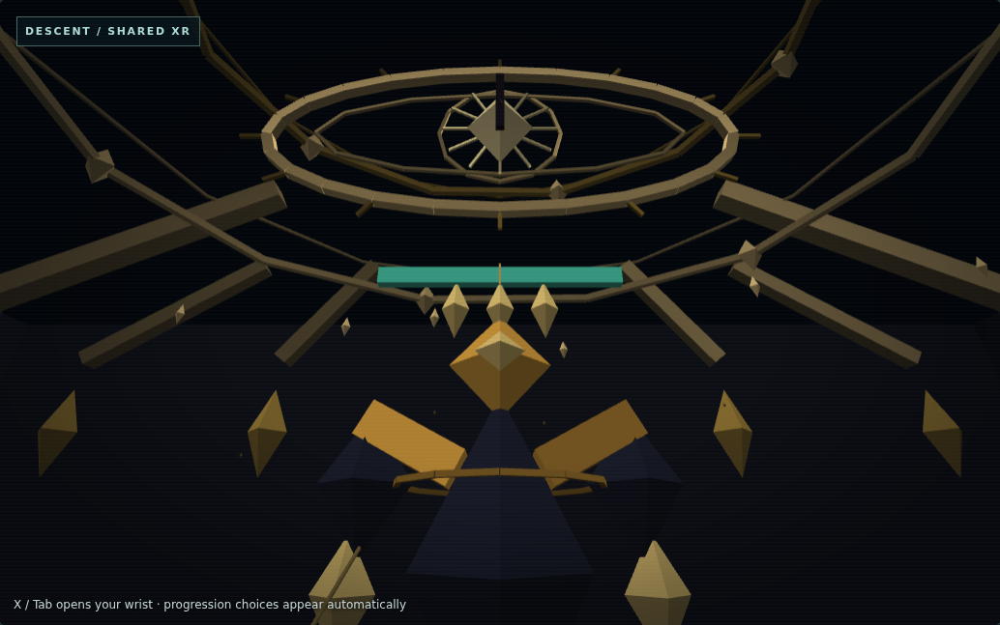

# SPARK VR: The Warden Awakens — Rung 3.5

The Demiurge's Eye now presents the **existing canonical Warden** through the
shared Guardian Presentation. This is a working software candidate based on
merged Rung 3 PR #23, main `4f615de026756e4b7800ff838008794ce5283506`.
Controlling scope: the user's **Rung 3.5 — The Demiurge's Eye** build mission.
Human review/merge and physical Quest 3 acceptance remain pending.

Open `vr/living.html`, select **Desktop 3D preview** or explicitly enter VR.
Classic remains the default. Reach the Eye through actual campaign gates or
restore your own earned VR checkpoint. There is no showcase unlock/kill button.
The original `vr/`, Ascension, desktop modes and separate online service remain.

## What changed

- Original obsidian/gold chamber, enormous overhead Eye with a gaze that follows
  the native player's position, celestial rings, ancient ribs and floating glyphs.
- Monumental procedural Warden armor, opening shoulders and charge rings driven
  by actual windup; health bar and wrist HP/phase use the native health fraction.
- Three/five locked attack paths, repeated at floor and projectile presentation
  height for seated readability. The same actual observed angles draw both sets.
  Moving bolts still use canonical projectile positions. Ground seals show the
  real radius and remaining timer. The two summoned hounds have distinct bodies,
  charge cues and bounded arrival rings at their actual positions.
- The actual half-health transition changes Eye/armor color, ring rhythm and
  bounded overhead motion. Optional synthesized spatial cues and controller
  pulses reuse the existing feedback layer; missing audio/haptics is harmless.
- Only a legitimate canonical defeat fractures the Eye, desynchronizes rings
  and dissolves the Warden into rising golden fragments. The paused wrist shows
  actual **run essence**, Stratum seal and Vessel Resonance state. It preserves
  the native chamber/boon choices and subsequent **Continue / Finish** milestone.
- The shared paused wrist now stays within a bounded, viewer-facing region to
  the left of center. Looking overhead or bringing a controller close cannot
  make it oversized. It remains hidden during active living-mode combat.
- The eastern Eye doorway remains visually clear. No new decorative collision
  surfaces or changes to canonical cover were introduced.

## Authority and reuse

`XR input v1 → existing fixed-step runtime → Descent adapter → stepVRPreview →
action-engine.js` still owns every action. The presentation reads
`guardianThreats(run)`, native enemies, effects and reward/progression state.
It cannot call damage, kill an enemy, grant loot, reset recovery or select an
ending. No engine, input protocol, simulation clock or save format was forked.

`spark.xr.guardian-presentation.v1` now has a small room/kind registry for the
Cantor and Warden, shared health/windup/ground-warning code and additive visual
fields. Warden body/hound geometry stays in that same module. The Cantor's
existing body, six/eight-note ring plus aimed-pair rules and forge response are
preserved. There is no speculative boss framework or additional combat adapter.

`spark.xr.room-theme.v1` gains the Eye theme using existing geometry helpers,
static cache and the three quality budgets. No renderer buffers/programs/textures
are created per frame. Room geometry is cached; existing renderer/session cleanup
deletes GPU resources and clears transient cues. Original effects and synthesis
are attributed in [ASSETS_AND_ATTRIBUTION](../../ASSETS_AND_ATTRIBUTION.md).

The Warden victory dissolution alone uses bounded monotonic **presentation** time
(2.8 seconds), so it completes while the real reward menu pauses the simulation.
Attack preparation, direction locking, release, phase selection, hazards and
rewards always use canonical observations. Ordinary ornament movement uses native
game time. Reduced effects freeze ornamental spin/bobbing and reduce fragments;
they retain readable attack/ground warnings. There is no camera shake, forced
view change, jumping requirement or large gesture requirement.

The enlarged armor and Eye are art, **not anatomical targets or extra hitboxes**.
Spark's original planar combat and directed attack validation remain authoritative.

| Preserved native rule | Phase one | Phase two |
|---|---|---|
| Solo maximum HP | 1,800 | Same boss; strictly below 900 HP |
| Aimed locked spread | `[-.2, 0, .2]` | `[-.36, -.18, 0, .18, .36]` |
| Windup | 0.8 seconds | 0.8 seconds |
| Bolt damage / speed | 14 / 220 | 16 / 260 |
| Attack timer reset after volley | 1.4 seconds | 0.9 seconds |
| Ground mark radius / life | 70 / 1.1 seconds | Unchanged |
| Mark clock reset | 3.6 seconds | 2.6 seconds |
| Transition summons | None | Exactly two native hounds, once |

Exactly half health remains phase one. The first spread still uses the engine's
initial two-second attack timer. Costs, invulnerability, dodge, contact damage,
range, hit resolution, powers and vessel transformations are unchanged.

`action-engine.js`, `attack-intent.js`, Duel/Sideways engines, campaign model,
input/runtime, save modules, desktop controls, More Bounce implementation/unlock,
package/lock files, Pages builder, backend and MIT license are unchanged.
Protected-file hashes are recorded in [verification.json](verification.json).

The VR checkpoint remains `spark-substrate-immersive-vr-v1`, schema
`spark.vr.local-checkpoint.v1`; no presentation state is added to the run. Original
Descent/Sideways/Duel saves and separate Spellcraft preferences keep their existing
namespaces. No online API, account or telemetry operation is introduced.

Paused checkpoint restoration seeds guardian visuals from canonical room/cleared
history before the first render. An earned Eye milestone therefore restores the
fractured Eye immediately, with no repeated defeat animation or cue. This also
handles older saves and later boss banners without changing the saved run.

## Software verification and evidence

Exact commands, results, fixture labels and protected-file checks are recorded in
[verification.json](verification.json). Browser measurements and native observations
are in [browser-results.json](browser-results.json); file hashes are in
[artifact-manifest.json](artifact-manifest.json).

| Executed check | Result |
|---|---|
| `npm test` | 459 passed, zero failures (451 existing + eight targeted tests) |
| `node --test tests/vr-*.test.mjs` | 91 passed, zero failures; subset of the above |
| `node --test tests/vr-warden.test.mjs` | Eight passed |
| `node scripts/build-pages.mjs` | Static artifact built |
| `node --test tests/pages-static.test.mjs` | Seven passed; subset of full suite |
| `node --check` for all `public/vr/*.js`, new browser/test modules | Passed |
| Ascension, Living, Awakening and Warden Chromium scripts | All four passed |
| `git diff --check` | Passed |

Browser execution used Chromium 153 with SwiftShader and isolated Playwright
development tooling, without installing dependencies into the app. Reproduce with
Playwright available or set `SPARK_PLAYWRIGHT_MODULE`; optionally set
`SPARK_CHROMIUM_PATH` for a locally installed browser:

```sh
node scripts/check-vr-ascension-browser.mjs
node scripts/check-vr-living-browser.mjs
node scripts/check-vr-awakening-browser.mjs
node scripts/check-vr-warden-browser.mjs
```

The Warden script builds and serves the **actual Pages staging artifact** under
`/SparkTheSubstrate/`, blocks all requests outside that local origin and imports
the real application. It uses synthetic tracked poses and legal actions through
the exported runtime, starting with a fresh native campaign:

`Threshold → Glass → Machine → Roots → Machine → Glass → Wild → Basalt → Foundry
→ Eye → Tideglass Harbor`.

It captures actual first/second-phase warnings, hounds and moving bolts, wins the
real fight with directed basics and native powers, resolves actual rewards, saves
the genuine milestone and branches that checkpoint to test both endings. It does
not write player HP, boss HP, rooms, abilities, kills, rewards or unlocks. The
branch test does not bank/duplicate rewards. This is **not a complete natural
seven-world campaign playthrough**. The separate Awakening script also completes
the real Cantor route and retains its existing checks.

Unit tests honestly use controlled canonical-entry and 899-HP fixtures for exact
timing/angle/threshold assertions. Native `enterGate` creates the untouched boss;
these fixtures are separate from browser campaign evidence and grant no test
unlock to players. Other tests prove presentation immutability, cleanup, reduced
budgets, doorway clearance, wrist bounds, Classic engagement, left-handed seated
Spellcraft, saves, native rewards, morphing and both Eye decisions. Existing
regressions continue to cover cooldowns, collisions, pose loss, authority, all
worlds/modes, online separation and More Bounce.

The Warden browser check submitted separate left/right views with a synthetic
64 mm eye separation. Both retained lit scene geometry; WebGL errors, browser
errors and remote requests were zero. Exit left zero live buffers, textures,
programs or audio voices. This demonstrates software rendering/lifecycle behavior,
not perceived stereo comfort or physical tracking.

### Actual rendered captures

All PNGs below are captures of the running game, with synthetic head/controller
poses. They are not generated concept art or Quest headset photographs. Looking
up/down for these views is a test-driver pose action, not a forced game camera.



| Capture | What actually occurred |
|---|---|
| [Three paths](warden-three-paths.png) | Native first-phase locked windup |
| [Hound summons](warden-summons.png) | Real below-half transition; hounds at native spawn positions (one can be outside the view) |
| [Five paths](warden-five-paths.png) | Native second-phase locked windup |
| [Five moving bolts](warden-five-bolts.png) | Actual second-phase projectile release |
| [Stereo wrist](warden-stereo-wrist.png) | Separate synthetic eyes, paused native phase/HP and readable menu |
| [Canonical victory](warden-victory.png) | Actual defeat/rewards; no scripted win |
| [Eye fracture](eye-fracture.png) | Voluntary overhead look during the real paused reward sequence |
| [Eye milestone](eye-milestone.png) | Actual Continue / Finish choices |

## Performance and limitations

The committed browser receipt contains eight measured frames per quality after
warmup, two synthetic eyes and the visible wrist during a native five-path/hound
moment. It records draw calls, submitted vertices, uploaded geometry bytes and
CPU submission median/p95. **No new GPU objects were allocated** in those measured
frames. Short SwiftShader timings are noisy; they are not GPU time, heap-allocation
proof, Quest FPS, refresh-rate compliance or sustained thermal evidence.

The Eye and extra lane/hound geometry increase per-frame vertex generation and
uploads. Performance/balanced/high detail and particle caps remain available;
reduced intensity limits ornamental movement. The implementation retains Spark's
existing per-frame CPU mesh construction. Real headset profiling is still needed.

Measured local sample (eight frames after warmup, **CPU submission only**):

| Quality | Median / p95 ms | Vertices submitted (two eyes) | Geometry upload KiB/frame |
|---|---:|---:|---:|
| performance | 9.4 / 18.9 | 34,248 | 258.2 |
| balanced | 13.2 / 17.4 | 44,856 | 357.2 |
| high | 9.6 / 12.9 | 58,872 | 487.7 |

Known boundaries: procedural faceted art, original planar hitboxes rather than
anatomical collision, bounded effects rather than a cinematic camera, optional
browser-dependent spatial sound/haptics, and no complete 126-room hardware run.
The optional new Field Lab readiness panel was deferred; the existing lab and
its manual checklist are extended instead. There are no unfinished new modes or
training contexts that can award progress.

## Quest 3 manual acceptance (not performed)

Use HTTPS Quest Browser and an earned Eye checkpoint or a real campaign route.
Follow the [extended Field Lab checklist](../QUEST3_FIELD_LAB.md#rung-35--the-warden-awakens-manual-extension):

1. Check both controllers/rays, recenter, seated floor height, stereo and exit.
2. Try Classic, each Spellcraft casting hand and native power; confirm HP/cadence.
3. Read three paths/marks, then five paths and two hounds below half health.
4. Try quality/reduced effects, speed/snap/vignette, optional sound and haptics;
   assess sustained comfort/performance. No camera shake or jumping is required.
5. Open/close the wrist, look overhead and move the wrist close/far. Interrupt
   tracking with held triggers; resume neutral without an unexpected cast.
6. Win legitimately; inspect fracture, dissolution, real rewards and both native
   Eye decisions using a saved milestone. Continue into Tideglass, then exit and
   re-enter. Confirm other campaign saves and online behavior remain independent.

Record observed failures and browser/device details. **Quest 3 hardware compatibility,
comfort and performance remain unverified. Do not mark hardware checks passed on
the basis of this software evidence.**
